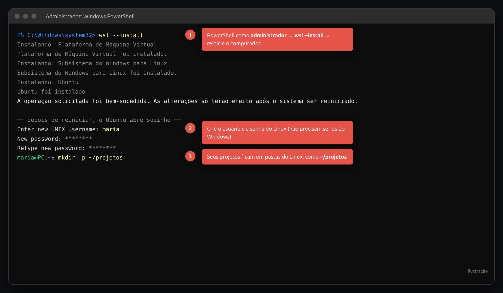
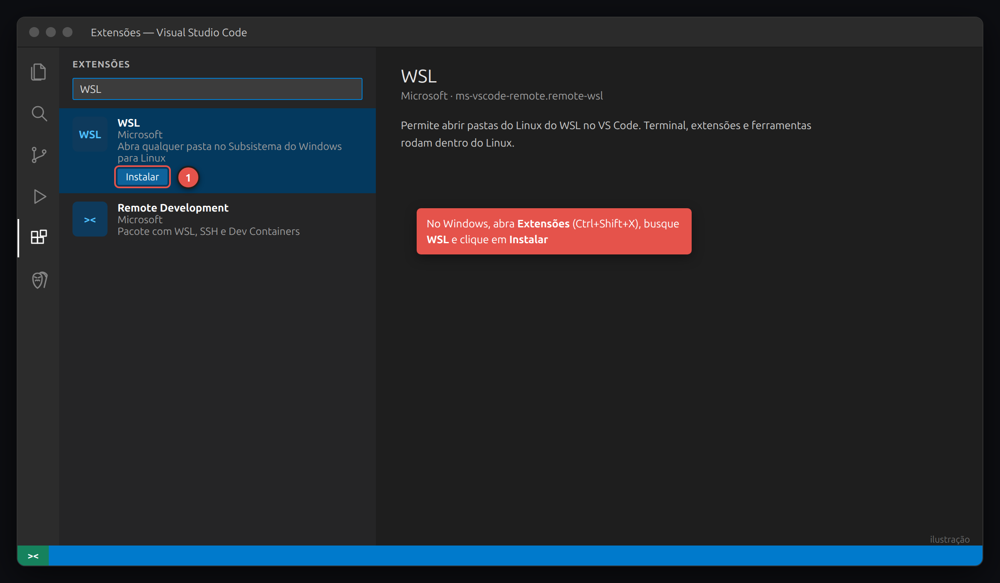
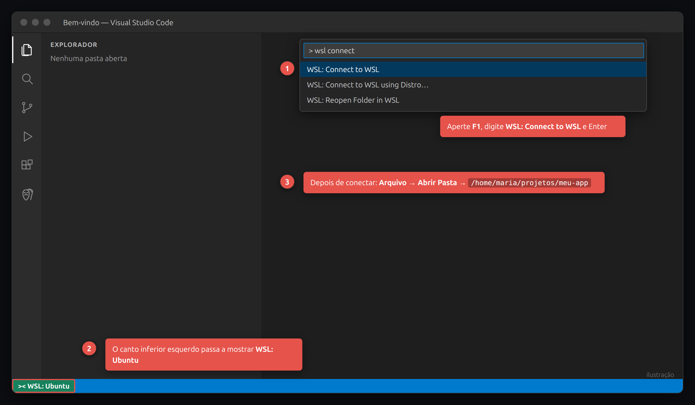
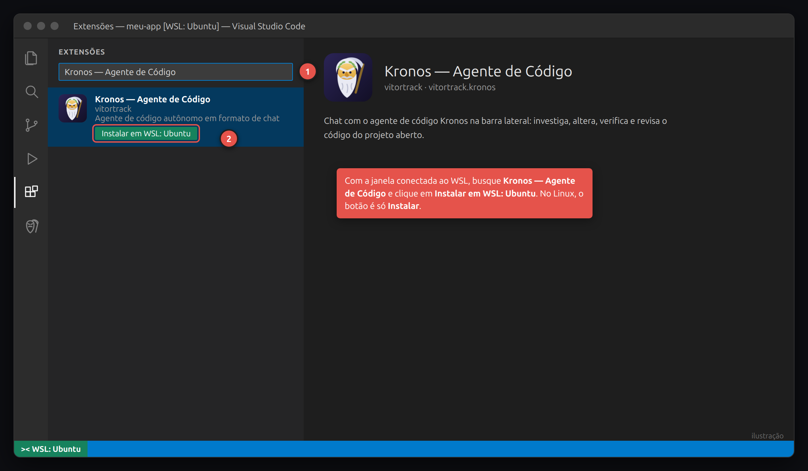
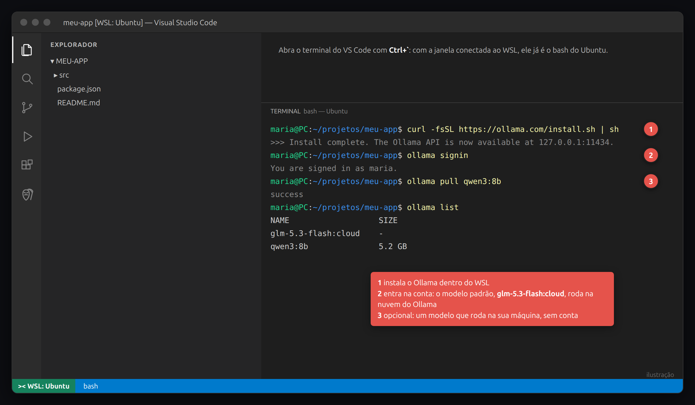
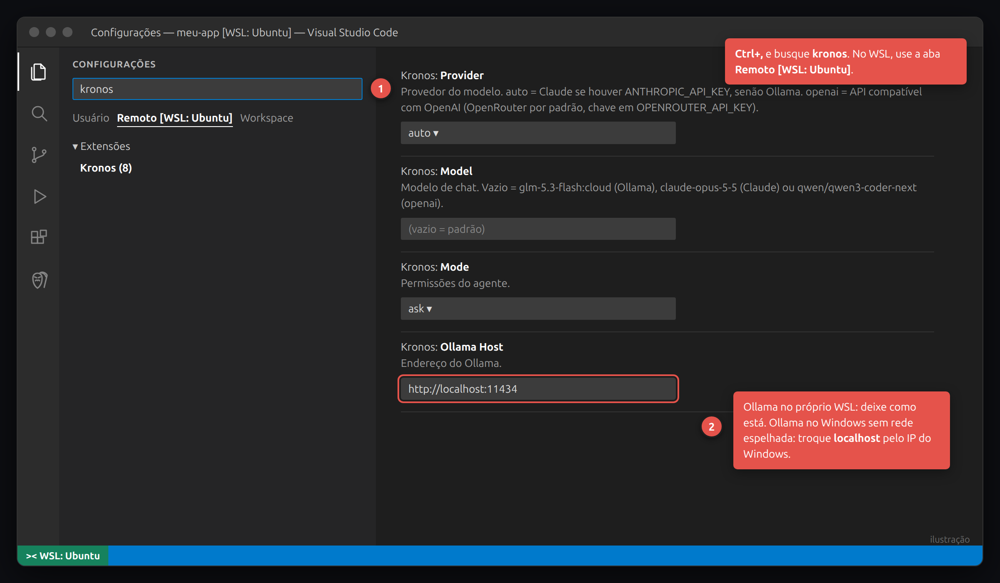
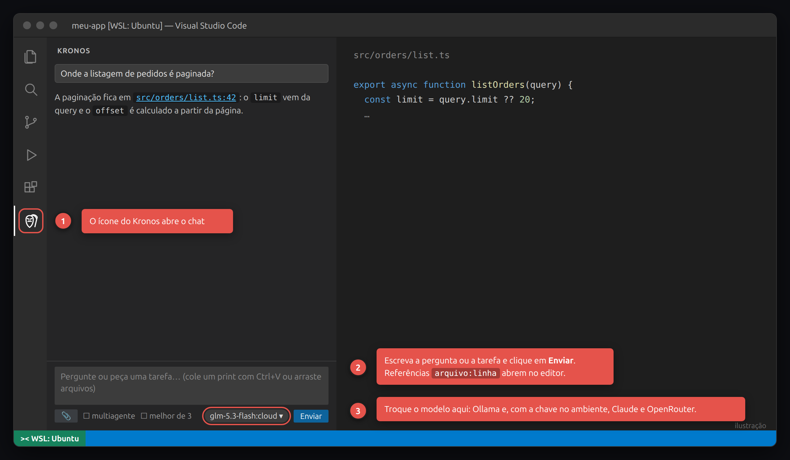

<p align="center">
  
</p>

<h1 align="center">Kronos</h1>

<p align="center">
  <strong>Agente de código autônomo para o terminal e o VS Code.</strong><br>
  Lê, entende, altera e verifica código no seu projeto — com modelos locais, na nuvem ou com Claude.
</p>

<p align="center">
  <a href="LICENSE"></a>
  
  
  
  
</p>

<p align="center">
  <a href="#instalação">Instalação</a> ·
  <a href="#extensão-do-vs-code">Extensão</a> ·
  <a href="#uso">Uso</a> ·
  <a href="#comandos">Comandos</a> ·
  <a href="#configuração-e-personalização">Configuração</a> ·
  <a href="#arquitetura">Arquitetura</a> ·
  <a href="#segurança">Segurança</a>
</p>

---

Raciocínio ReAct (pensar → agir → observar), planejamento, autocorreção, conclusão com revisão do diff, detector de travamento, orquestração multiagente e ferramentas externas via MCP. O motor segue a documentação pública de agentes da Anthropic e mecanismos medidos de agentes abertos (Codex CLI, Gemini CLI, SWE-agent, OpenHands).

Roda **100% local** com [Ollama](https://ollama.com), com modelos na nuvem pelo [OpenRouter](https://openrouter.ai) (ou qualquer API compatível com OpenAI) ou com **Claude** (API da Anthropic).

```text
› Os testes estão falhando. Encontre a causa raiz e corrija.
⚙ read_file path=src/cart.js
⚙ bash command=npm test
Causa raiz: o laço começa em i = 1 e pula o primeiro item…
⚙ edit_file path=src/cart.js …
⚙ bash command=npm test        ✓ all tests passed
│ critic#1 ⚙ bash command=git diff   …
ℹ revisor aprovou o trabalho
```

## Requisitos

O mesmo núcleo roda no CLI e na extensão do VS Code, então os requisitos são os mesmos, com duas diferenças: o CLI precisa de **Node.js 22+**, e a extensão precisa de **VS Code 1.90+** (ela já leva o Node do próprio VS Code e o código do Kronos dentro do `.vsix`, sem precisar de Node nem npm na máquina).

**Obrigatório**

- **Um modelo**, de uma destas formas:
  - **Ollama** instalado e rodando em `http://localhost:11434`. Para outro endereço, use `OLLAMA_HOST` no CLI ou *Settings → Kronos → Ollama Host* na extensão. O modelo padrão, `glm-5.3-flash:cloud`, roda na nuvem do Ollama: é preciso entrar na conta com `ollama signin`. Modelos locais (`-m qwen3:8b`, por exemplo) não precisam de conta, só de `ollama pull`.
  - **Ou Claude**, com `ANTHROPIC_API_KEY` no ambiente. Na extensão, a variável precisa existir no ambiente em que o VS Code foi aberto.
  - **Ou uma API compatível com OpenAI** (OpenRouter por padrão), com `OPENROUTER_API_KEY` no ambiente e `-p openai`. O modelo padrão é `qwen/qwen3-coder-next`; outro endereço vai em `OPENAI_BASE_URL`.
- **Linux ou macOS, com `bash`, `git`, `grep` e `find` no PATH** (os dois já trazem). A extensão do VS Code é publicada só para Linux x64; no macOS, use o CLI. No **Windows**, o Kronos roda dentro do WSL: veja o [Guia passo a passo](#guia-passo-a-passo-vs-code).

O agente roda no laço próprio do Kronos, com o modelo configurado — Ollama, Claude (pela API, com `ANTHROPIC_API_KEY`) ou uma API compatível com OpenAI. O modo multiagente (`--orchestrate`), as checagens de pronto (`--gate`) e a reescrita de harness (`src/rhi.ts`) usam esse mesmo modelo, por meio de um agente só de leitura que devolve as decisões em JSON validado.

**Opcional, por recurso**

| Recurso | Precisa de | Sem ele |
|---|---|---|
| Reverter edições que deixam erro de tipo | TypeScript instalado no projeto aberto | a checagem não roda e a edição é aplicada |

## Instalação

```bash
npm install
npm run build
npm link            # deixa o comando `kronos` disponível no sistema
```

Ollama (padrão quando não há chave da Anthropic):

```bash
curl -fsSL https://ollama.com/install.sh | sh
ollama signin            # o modelo padrão, glm-5.3-flash:cloud, roda na nuvem do Ollama
ollama pull qwen3:8b     # opcional: modelo local, sem conta (use com -m qwen3:8b)
```

Claude: exporte `ANTHROPIC_API_KEY` e o Kronos passa a usar `claude-opus-5-5` (ou force com `-p anthropic`).

OpenRouter: exporte `OPENROUTER_API_KEY` e rode com `-p openai` (modelo padrão `qwen/qwen3-coder-next`; outro com `-m`).

## Extensão do VS Code

Chat do Kronos na barra lateral (ícone do Kronos, o rosto com a foice), com o mesmo núcleo do CLI.

Instale pelo painel **Extensões** do VS Code, buscando **Kronos — Agente de Código** — o [Guia passo a passo](#guia-passo-a-passo-vs-code) mostra cada etapa, inclusive no Windows. Ou gere o pacote a partir do código:

```bash
cd vscode
npm install
npm run package                                   # gera kronos-linux-x64-<versão>.vsix
code --install-extension kronos-linux-x64-*.vsix --force
```

Configurações em *Settings → Kronos*. O modelo também pode ser trocado no seletor do chat, que lista os modelos instalados no Ollama, os do Claude (com `ANTHROPIC_API_KEY`) e os do OpenRouter (com `OPENROUTER_API_KEY`). Referências `arquivo:linha` abrem no editor; permissões aparecem como botões Permitir/Negar; prints e arquivos podem ser anexados (📎, Ctrl+V ou arrastar): imagens vão para o modelo quando ele tem visão, PDFs viram texto com `pdftotext`. A opção **multiagente** usa o mesmo fluxo do `--orchestrate`, e **melhor de 3** o do `--attempts 3`.

## Guia passo a passo (VS Code)

Do zero até a primeira pergunta no chat. **No Linux, pule para o passo 4.** No Windows, o Kronos roda dentro do **WSL** (o Linux integrado ao Windows), porque chama `bash`, `grep` e `find` diretamente; o Windows sem WSL não é suportado.

> As imagens são ilustrações do que aparece em cada passo, não capturas de tela.

### 1. Instalar o WSL (só no Windows)

Abra o **PowerShell como administrador** (menu Iniciar → digite *PowerShell* → *Executar como administrador*), rode `wsl --install` e reinicie o computador. Depois de reiniciar, o Ubuntu abre sozinho e pede um usuário e uma senha para o Linux.



Guia oficial: [Instalar o WSL](https://learn.microsoft.com/pt-br/windows/wsl/install).

### 2. Instalar a extensão WSL no VS Code (só no Windows)

No VS Code do Windows, abra **Extensões** (`Ctrl+Shift+X`), busque **WSL** (da Microsoft) e clique em **Instalar**.



### 3. Abrir o projeto dentro do WSL (só no Windows)

Aperte `F1`, digite **WSL: Connect to WSL** e Enter. Uma janela nova abre conectada ao Ubuntu: o canto inferior esquerdo mostra **WSL: Ubuntu**. Nela, use **Arquivo → Abrir Pasta** numa pasta do Linux (por exemplo `/home/maria/projetos/meu-app`).



Prefira pastas do Linux a `/mnt/c/...`: no disco do Windows, `git`, buscas e testes ficam bem mais lentos. Guia oficial: [Desenvolver no WSL com o VS Code](https://code.visualstudio.com/docs/remote/wsl).

### 4. Instalar o Kronos

Em **Extensões**, busque **Kronos — Agente de Código** (publicado por *vitortrack*) e clique em **Instalar**. No Windows, com a janela conectada ao WSL, o botão aparece como **Instalar em WSL: Ubuntu**.



### 5. Instalar o Ollama e os modelos

Abra o terminal do VS Code com ``Ctrl+` `` (no Windows conectado ao WSL, ele já é o bash do Ubuntu) e rode:

```bash
curl -fsSL https://ollama.com/install.sh | sh   # instala o Ollama
ollama signin                                    # entra na conta: o modelo padrão (glm-5.3-flash:cloud) roda na nuvem do Ollama
```



Guia oficial: [Ollama no Linux](https://docs.ollama.com/linux). Para rodar um modelo na sua máquina, sem conta, use `ollama pull qwen3:8b` (ou outro) e escolha-o no passo 7.

Outras formas de ter o modelo:
- **Ollama instalado no Windows** (fora do WSL), pelo [instalador do Windows](https://ollama.com/download/windows): ligue a rede espelhada do WSL para o `localhost` do WSL chegar no Windows. Crie o arquivo `%UserProfile%\.wslconfig` com:
  ```ini
  [wsl2]
  networkingMode=mirrored
  ```
  e rode `wsl --shutdown` no PowerShell. Guia oficial: [Rede espelhada do WSL](https://learn.microsoft.com/pt-br/windows/wsl/networking#mirrored-mode-networking). Sem isso, troque o *Ollama Host* do passo 6 pelo IP do Windows.
- **Claude**, em vez do Ollama: exporte `ANTHROPIC_API_KEY` no `~/.bashrc` e reabra a janela do VS Code (no Windows, a janela conectada ao WSL).
- **OpenRouter**: exporte `OPENROUTER_API_KEY` no `~/.bashrc` e reabra a janela do VS Code; `qwen/qwen3-coder-next` aparece no seletor de modelos do chat.

### 6. Conferir as configurações

Abra as configurações com `Ctrl+,` e busque **kronos**. No Windows, mude na aba **Remoto [WSL: Ubuntu]**. Os padrões já funcionam com o Ollama do passo 5; o que costuma mudar:

| Configuração | Quando mudar |
|---|---|
| **Provider** | `auto` usa o Claude se houver `ANTHROPIC_API_KEY`, senão o Ollama; `openai` usa o OpenRouter (`OPENROUTER_API_KEY`) |
| **Model** | vazio = `glm-5.3-flash:cloud` (Ollama), `claude-opus-5-5` (Claude) ou `qwen/qwen3-coder-next` (openai) |
| **Mode** | `ask` pede confirmação para escrever e rodar comandos; `auto` só confirma comandos destrutivos; `read-only` nunca altera nada |
| **Ollama Host** | só se o Ollama estiver em outro endereço (por exemplo no Windows, sem rede espelhada) |



### 7. Usar o chat

Clique no **ícone do Kronos** (o rosto com a foice) na barra lateral, escreva a pergunta ou a tarefa e clique em **Enviar**. Referências `arquivo:linha` nas respostas abrem o arquivo na linha. O seletor ao lado do *Enviar* troca o modelo entre os instalados no Ollama e, com a chave no ambiente, os do Claude e do OpenRouter.



### Usar o CLI no WSL

O comando `kronos` também roda no WSL: instale o Node.js 22+ dentro do Ubuntu (por exemplo com [nvm](https://github.com/nvm-sh/nvm)) e siga a [Instalação](#instalação) no terminal do WSL.

## Uso

```bash
kronos                                   # modo interativo na pasta atual
kronos "adicione paginação na listagem"  # executa e sai
kronos -C ../meu-projeto --mode auto "corrija o build"
kronos --orchestrate "crie o módulo de cupons com testes"
kronos --gate --gate-file card-746.json "implemente o card 746"
kronos -p anthropic --effort xhigh "investigue o vazamento de memória"
```

| Opção | Descrição |
|---|---|
| `-p, --provider ollama\|anthropic\|openai` | provedor do modelo |
| `-m, --model <nome>` | modelo (`glm-5.3-flash:cloud`, `qwen3:8b`, `claude-opus-5-5`, …) |
| `--mode ask\|auto\|read-only` | `ask` pede confirmação para escrita e `bash` (comandos só de leitura, como `ls`, `grep` e `find`, passam direto); `auto` só confirma comandos destrutivos; `read-only` bloqueia tudo que altera |
| `-C, --cwd <dir>` | pasta de trabalho (o agente não acessa arquivos fora dela) |
| `--orchestrate` | contrato (fatias de 1–3 arquivos, cada critério com uma checagem em bash, validada contra o código atual) → cada fatia em contexto limpo, com portão de até 3 tentativas → uma revisão final |
| `--gate` | o modelo escreve as checagens de pronto numa chamada; o agente só conclui quando todas passam, mais um critério fixo de diff mínimo julgado pelo modelo |
| `--gate-file <arquivo>` | reaproveita as checagens salvas nesse arquivo ou grava as novas nele |
| `--harness <arquivo>` | texto de harness específico da tarefa (RHI), posto antes do pedido |
| `--handoff <arquivo>` | lê a nota da execução anterior no início e grava a nota desta no fim |
| `--attempts <n>` | melhor de N: tentativas isoladas, fica a que passa nos testes com o menor diff |
| `--review-model <modelo>` | a revisão roda noutro modelo (ex.: um modelo maior do Ollama), como agente crítico do próprio motor Kronos, só leitura, e já liga a revisão; a tarefa continua no modelo principal. Modelos `claude-*` usam o provedor Anthropic do Kronos (exige `ANTHROPIC_API_KEY`). Também `KRONOS_REVIEW_MODEL` e, na extensão, `kronos.reviewModel` |
| `--review` | liga a revisão por um agente crítico (padrão: desligada; medido: mesmo acerto e 19–38% menos tokens sem ela, com a checagem de escopo e o portão de verificação sempre ativos) |
| `--no-review` | desliga a revisão mesmo com `--review-model` ou `KRONOS_REVIEW_MODEL` definidos |
| `--max-steps <n>` | limite de passos por agente (padrão 80) |
| `--budget <tokens>` | para quando o consumo total passar do limite |
| `--effort <nível>` | esforço de raciocínio do Claude (`low` … `max`) |
| `--num-ctx <n>` | janela de contexto do Ollama (padrão 65536) |
| `--lang <idioma>` | idioma de tudo o que o agente escreve: `pt-BR` (padrão), `en`, `es`, `fr`, `de`, `it` ou `auto` (o da pergunta) |
| `--thinking` | mostra o raciocínio do modelo (por padrão aparece só "✻ pensando…") |
| `--no-log` | não grava o trace da sessão em `~/.kronos/sessions` |
| `-c`, `--continue` | retoma a última conversa deste projeto |
| `-r`, `--resume <id>` | retoma uma conversa salva |
| `--fork` | com `-c` ou `-r`: continua numa cópia, sem alterar a original |

### Comandos

No modo interativo do CLI, digite o comando no lugar da tarefa. Na extensão, digite `/` no chat: os comandos marcados como **CLI e extensão** aparecem no menu junto com as skills. No menu, **Enter** escolhe e já envia; **Tab** só completa, para você digitar o argumento (ex.: `/compact` + foco, `/mcp ligar` + servidor). **Ctrl+C** (ou **Parar**, na extensão) interrompe a tarefa em andamento sem sair.

| Comando | Onde | O que faz |
|---|---|---|
| `/usage` | CLI e extensão | Tokens e custo da conversa, barra de **contexto** (quanto da janela o último passo usou e em que ponto compacta sozinho) e, no OpenRouter, barras de **limite da chave** e **créditos da conta**, com o ritmo de gasto e quanto o saldo dura |
| `/compact [foco]` | CLI e extensão | Resume o histórico agora, sem esperar a compactação automática, para os próximos passos enviarem menos tokens. O foco opcional diz o que o resumo deve preservar (ex.: `/compact nomes das migrations`). Ollama e OpenRouter |
| `/clear` | CLI e extensão | Começa uma conversa nova (na extensão, o mesmo que **Nova conversa**) |
| `/mcp [ligar\|desligar <servidor> \| importar]` | CLI e extensão | Servidores MCP: de onde cada um veio, quantas ferramentas tem ou por que falhou; liga, desliga ou traz os do Claude Code (veja [MCP](#mcp)) |
| `/plugins [instalar <url-ou-pasta> \| remover <nome>]` | CLI e extensão | Plugins em uso, com as skills e os servidores MCP de cada um; instala ou remove plugins do Kronos (veja [Plugins](#plugins)) |
| `/init` | CLI e extensão | O agente explora o projeto e cria ou melhora o `AGENTS.md` (comandos de build e teste, arquitetura, regras não óbvias) |
| `/<skill> [texto]` | CLI e extensão | Liga a skill na conversa; `/<skill> off` desliga |
| `/plan` | CLI | Mostra o plano atual |
| `/mode ask\|auto\|read-only` | CLI | Muda o modo de permissão |
| `/review on\|off` | CLI | Liga ou desliga a revisão por agente crítico |
| `/lang <idioma>` | CLI | Idioma das respostas (`pt-BR`, `en`, `es`, …, `auto`) |
| `/traduzir [idioma]` | CLI | Traduz a última resposta |
| `/thinking on\|off` | CLI | Mostra ou esconde o raciocínio do modelo |
| `/orchestrate <tarefa>` | CLI | Roda a tarefa no pipeline multiagente |
| `/sessions`, `/resume <id>`, `/fork` | CLI | Lista, retoma ou copia conversas salvas |
| `/help`, `/exit` | CLI | Ajuda e saída |

Cada conversa é salva ao fim de cada tarefa em `~/.kronos/projects/<projeto>/sessions/<id>.json` (histórico do agente, pedidos e respostas, plano e uso). A extensão do VS Code restaura a conversa aberta quando a janela recarrega; **Nova conversa** começa outra.

### Fazendo perguntas

```bash
kronos -C ../meu-projeto --mode read-only
› Como funciona a consulta pública de protocolo? O que reutilizar para criar outra?
› /traduzir en          # a última resposta, em inglês
› /lang es              # daqui em diante, tudo em espanhol
```

O agente lê os arquivos envolvidos antes de responder (não especula sobre código que não abriu) e responde em texto, sem passar pelo `finish`:

- **resposta direta** primeiro;
- **evidência** com `arquivo:linha` e só os trechos relevantes do código;
- **o que não foi verificado**, dito explicitamente.

A saída é Markdown renderizado no terminal (títulos, listas, negrito, blocos de código).

## Arquitetura

```text
             ┌──────────────── Session ────────────────┐
 usuário ──▶ │  Agent (main) ── ReAct loop ──▶ Tools    │──▶ workspace
             │     │  ▲                         │        │
             │     │  └── observações / erros ◀─┘        │
             │     ├─ delegate ─▶ Agent (explorer|worker)│
             │     ├─ conclusão: finish · portão · verif.│
             │     └─ review (--review) ─▶ Agent (critic)│
             │  Orchestrator: planner → workers → critic │
             │  Provider: Ollama | Anthropic | OpenAI    │
             │  Trace JSONL · tokens · custo · travas    │
             └───────────────────────────────────────────┘
```

| Componente | Como está implementado | Onde |
|---|---|---|
| **1. Núcleo cognitivo** | Persona de engenheiro sênior, método de resolução (evidência → causa raiz → decisão → verificação → reflexão → aprendizado), guardrails (escopo, segredos, ações destrutivas) e um prompt por papel (main, worker, explorer, planner, critic). Instruções do projeto em `KRONOS.md`, `AGENTS.md` ou `CLAUDE.md` são carregadas automaticamente. | `src/prompts.ts` |
| **2. Memória** | Histórico da sessão com compactação automática quando a janela do modelo enche: um resumo em cinco seções (visão da tarefa, estado atual, descobertas, próximos passos, contexto a preservar) com o pedido original fixo e os arquivos lidos por último. Saídas antigas de ferramenta são mascaradas em blocos de 10, saídas idênticas ficam só na cópia mais nova e argumentos grandes de chamadas antigas são encurtados. Com Claude, a compactação roda no servidor da Anthropic. Entre execuções, a continuidade vem da nota de passagem (`--handoff`). | `src/providers/ollama.ts`, `src/providers/anthropic.ts` |
| **3. Planejamento** | Laço ReAct; planner dedicado no modo `--orchestrate`; autocorreção (o erro volta como observação estruturada). **Conclusão:** a ferramenta `finish` mostra o diff e um checklist na primeira chamada e encerra na segunda; antes de encerrar rodam o portão de checagens (`--gate`), o pedido de verificação (se mexeu em código e não rodou nada depois) e o revisor opcional (`--review`), com no máximo 8 bloqueios. Resposta só em texto também encerra (perguntas). **Ritmo:** "Please continue." quando o modelo anuncia a próxima ação e para; nova tentativa em resposta vazia; aviso para concluir quando a última edição já foi verificada e nada mudou há 6 passos. | `src/agent.ts`, `src/orchestrator.ts` |
| **4. Ferramentas** | `bash`, `read_file`, `write_file`, `edit_file`, `glob`, `grep`, `update_plan`, `delegate`, `finish` e `skill` (só quando há skills); `web_fetch` e as ferramentas MCP entram com `load_tools` ou com uma skill que as cite. Cada descrição diz o que a ferramenta faz, quando usar e quando não usar, os limites e um exemplo. Nome de ferramenta errado recebe as mais parecidas ("Did you mean"). O `bash` devolve `Exit code`, `Wall time` e a saída. Saída maior que 1.500 caracteres também é gravada em `.kronos/`; acima de 20 mil, o modelo recebe só o início (2.400 caracteres), o fim (3.600) e o caminho do arquivo. Entradas validadas contra o schema; caminhos presos ao workspace (inclusive via symlink); permissões por modo; detecção de comandos destrutivos; leitura de `.env` e do ambiente de containers sempre pede confirmação. | `src/tools.ts`, `src/validate.ts` |
| **5. Observabilidade** | Trace de cada passo (texto do modelo, chamadas, resultados, tokens e custo) em `~/.kronos/sessions/*.jsonl`; contagem de tokens e custo estimado ao fim de cada tarefa; estado final de cada execução (sucesso, limite de passos, orçamento, laço, recusa, interrupção); travas contra loop (limite de passos, orçamento de tokens e detector de travamento: a mesma chamada com o mesmo resultado 4 vezes, o mesmo erro 3 vezes ou um ciclo A/B gera um aviso e, se repetir, encerra) e Ctrl+C para interromper. | `src/session.ts`, `src/agent.ts` |

**Multiagente.** O agente principal age como gerente: delega pesquisa ampla a *explorers* (somente leitura, rodam em paralelo) e subtarefas independentes a *workers*, e cada sub-agente começa com contexto limpo. No `--orchestrate`, o fluxo é contrato → fatias com portão → revisão (veja a tabela de opções).

**Motor de decisão.** Contratos, checagens de pronto, o critério de diff mínimo e o RHI (`src/rhi.ts`: `refine`, `compare` e `digest` do texto de harness) usam um juiz do próprio Kronos, com o mesmo modelo do agente, que devolve JSON validado contra um schema.

**Robustez com modelos locais.** Modelos menores às vezes escrevem a chamada de ferramenta como texto (`<tool_call>…`, bloco JSON). O provedor do Ollama reconhece esses formatos e executa a chamada mesmo assim. Números enviados como string são convertidos automaticamente.

## Configuração e personalização

O Kronos tem configuração **própria**, em `~/.kronos/` (vale para todos os projetos) e em `.kronos/` dentro do projeto (vale só para ele). Para quem já usa o Claude Code, ele também lê a configuração do Claude Code, mas **só como reserva**: quando os dois têm algo com o mesmo nome, vale o do Kronos; o que só existe no Claude Code entra para completar. `KRONOS_CLAUDE_CONFIG=off` desliga a reserva e deixa o Kronos só com o que é dele.

Arquivos que fazem parte do **repositório** (`AGENTS.md`, `CLAUDE.md`, `.claude/skills/`, `.mcp.json`) não são configuração do Claude Code, e sim do projeto: o Kronos sempre os lê, com ou sem a reserva.

Nada é delegado ao Claude Code: o Kronos não chama o Claude Code nem precisa que ele esteja aberto ou instalado. A reserva é só leitura de arquivos.

### Mapa: onde o Kronos lê cada coisa

| O quê | Kronos (prioridade) | Repositório | Reserva do Claude Code |
|---|---|---|---|
| Instruções do usuário | `~/.kronos/KRONOS.md` | — | `~/.claude/CLAUDE.md` |
| Instruções do projeto | `KRONOS.md` | `AGENTS.md`, `CLAUDE.md`, `.claude/CLAUDE.md`, `CLAUDE.local.md` | — |
| Instruções por pasta | `KRONOS.md` na pasta | `AGENTS.md`, `CLAUDE.md` na pasta | — |
| Skills do projeto | `.kronos/skills/` | `.claude/skills/`, `.agents/skills/` | — |
| Skills do usuário | `~/.kronos/skills/` | — | `~/.claude/skills/` |
| Plugins | `~/.kronos/plugins/` | — | `~/.claude/plugins/` (instalados pelo `/plugin` do Claude Code) |
| Servidores MCP | `.kronos/mcp.json`, `~/.kronos/mcp.json`, `.mcp.json` dos plugins do Kronos | `.mcp.json` | `~/.claude.json` (do projeto e do usuário), `.mcp.json` dos plugins do Claude Code |
| Liga, desliga e aprovação de MCP | `~/.kronos/mcp-state.json` | — | `enabledMcpjsonServers`, `disabledMcpjsonServers`, `enableAllProjectMcpServers` |
| Conversas salvas | `~/.kronos/projects/<projeto>/sessions/` | — | — |
| Trace de cada sessão | `~/.kronos/sessions/` | — | — |
| Preferências da extensão | configurações `kronos.*` do VS Code | — | — |

`KRONOS_HOME` muda a pasta `~/.kronos` (os testes e a avaliação usam uma pasta temporária).

### Instruções (o equivalente ao CLAUDE.md)

Arquivos Markdown com as regras que o agente deve seguir: comandos de build e teste, convenções, o que não fazer. O Kronos os coloca no prompt de sistema no início de cada tarefa, nesta ordem:

1. **Do usuário:** `~/.kronos/KRONOS.md`. Se ele não existir, entra o `~/.claude/CLAUDE.md` como reserva. Só um dos dois é lido.
2. **Do projeto**, todos os que existirem na raiz: `KRONOS.md`, `AGENTS.md`, `CLAUDE.md`, `.claude/CLAUDE.md` e `CLAUDE.local.md`.

Cada arquivo entra com até 12 000 caracteres. Use `KRONOS.md` para o que vale só para o Kronos e `AGENTS.md` para o que vale para qualquer agente de código. `CLAUDE.local.md`, como no Claude Code, é para as suas notas pessoais do projeto (deixe-o no `.gitignore`).

**Instruções por pasta.** Quando o agente lê um arquivo, o Kronos procura `AGENTS.md`, `CLAUDE.md` e `KRONOS.md` em cada pasta entre a raiz e esse arquivo e os entrega junto com o conteúdo, uma vez por conversa e com até 8 000 caracteres cada. Assim as regras de `db/` ou `api/src/modules/escola/` chegam só quando o trabalho passa por ali, sem pesar no prompt das outras tarefas.

**Criar o arquivo.** `/init` faz o agente explorar o projeto e escrever (ou melhorar) o `AGENTS.md` com os comandos de instalação, build, testes e execução, a arquitetura em poucas linhas e as regras que não dá para adivinhar lendo o código.

**Diferenças do Claude Code.** O Kronos não segue `@imports` dentro desses arquivos e não sobe para as pastas acima da raiz do projeto.

### Skills

Uma skill é uma pasta com um `SKILL.md`, no mesmo formato do Claude Code:

```markdown
---
name: nova-migration
description: Use ao criar ou alterar tabelas do banco (migrations em db/init).
allowed-tools: bash
---

# Como criar uma migration

1. Crie `db/init/NNN_descricao.sql` com o próximo número livre.
2. ...
```

- **`name`**: como a skill é chamada. Se faltar, vale o nome da pasta.
- **`description`**: quando usar, em uma frase. Sem ela, a skill é ignorada.
- **`allowed-tools`** (opcional): ferramentas que a skill libera quando o agente a carrega.
- Outros arquivos da pasta (exemplos, modelos, referências) ficam disponíveis para o agente ler junto com a skill.

**Onde criar.** Com o mesmo nome, vale a primeira desta lista:

| # | Pasta | Para quê |
|---|---|---|
| 1 | `.kronos/skills/<nome>/` | do projeto, só para o Kronos |
| 2 | `.claude/skills/<nome>/` | do projeto, compartilhada com o Claude Code |
| 3 | `.agents/skills/<nome>/` | do projeto, compartilhada com outros agentes |
| 4 | `~/.kronos/skills/<nome>/` | sua, em todos os projetos (é também onde o Kronos grava as que cria sozinho) |
| 5 | `~/.kronos/plugins/<plugin>/skills/<nome>/` | de um plugin do Kronos, chamada `<plugin>:<nome>` |
| 6 | `~/.claude/skills/<nome>/` | reserva: suas skills do Claude Code |
| 7 | skills dos plugins do Claude Code | reserva, chamadas `<plugin>:<nome>` |

Para criar uma skill à mão, crie a pasta e o `SKILL.md`. Ela aparece na próxima conversa (`/clear` ou **Nova conversa**).

**Como o agente usa.** O prompt traz só o nome e a descrição de cada skill. Quando a tarefa combina, o agente carrega o texto completo com a ferramenta `skill`. Você também pode ligar uma skill: digite `/<nome>` (na extensão, ela aparece no menu do `/`) e ela vale para a conversa inteira, inclusive depois da compactação. `/<nome> off` desliga. Sem nenhuma skill, nada muda no prompt nem nas ferramentas. Na avaliação, com uma regra de projeto que só existia numa skill, o acerto subiu de 12/20 para 19/20, e o agente carregou a skill nas 20 execuções.

**Skills criadas pelo próprio Kronos.** Depois de uma tarefa com 10 passos ou mais, uma chamada separada relê a conversa e decide se vale criar ou atualizar uma skill para aquele *tipo* de tarefa. Isso acontece, por exemplo, quando você corrigiu o jeito de trabalhar do agente ou quando surgiu uma técnica reaproveitável. Ela grava só em `~/.kronos/skills/`. As skills do projeto, as dos plugins e as do Claude Code nunca são alteradas, e uma skill nova nunca usa o nome de uma delas. `KRONOS_USER_SKILLS=off` desliga essa revisão e todas as skills de usuário e de plugins (a avaliação roda assim).

### Plugins

Um plugin é uma pasta que agrupa skills e servidores MCP, no mesmo formato dos plugins do Claude Code:

```text
meu-plugin/
├── skills/
│   └── revisar-pr/SKILL.md      → /meu-plugin:revisar-pr
├── .mcp.json                    → servidores MCP do plugin (opcional)
└── .claude-plugin/plugin.json   → opcional; "skills": [...] lista as pastas de skills
```

| Comando | O que faz |
|---|---|
| `/plugins` | Lista os plugins em uso, com as skills e os servidores de cada um, marcando os que vêm da reserva do Claude Code |
| `/plugins instalar <url-git>` | Clona o repositório (`git clone --depth 1`) em `~/.kronos/plugins/<nome>` |
| `/plugins instalar <pasta>` | Copia a pasta (sem `node_modules`) para `~/.kronos/plugins/<nome>` |
| `/plugins remover <nome>` | Apaga o plugin de `~/.kronos/plugins` |

A instalação recusa uma pasta que não tenha `skills/`, `.mcp.json` ou `.claude-plugin/`. Ela também recusa um nome que já esteja instalado. Um plugin do Kronos com o mesmo nome de um do Claude Code tem prioridade sobre ele. Os plugins do Claude Code aparecem como reserva e são instalados e removidos pelo próprio Claude Code. Dentro do `.mcp.json` de um plugin, `${CLAUDE_PLUGIN_ROOT}` vira a pasta do plugin. As pastas `commands/`, `agents/` e `hooks/` dos plugins do Claude Code não são usadas.

### MCP

O Kronos é um cliente [MCP](https://modelcontextprotocol.io) para ferramentas. Ele conecta a servidores por **stdio** (um processo local) e por **HTTP** (*streamable HTTP*), lista as ferramentas de cada um e deixa o agente chamá-las, tanto as de leitura (consultar um banco, ler um ticket) quanto as de escrita (executar um comando, criar um registro). Cada servidor stdio é um processo do próprio Kronos: ele sobe na primeira tarefa da conversa e é encerrado quando o Kronos sai.

**De onde vêm os servidores.** O formato é o mesmo do Claude Code (`mcpServers`). Com o mesmo nome, vale o primeiro desta lista:

| # | Fonte | Escopo | Precisa ser liberado? |
|---|---|---|---|
| 1 | `.kronos/mcp.json` | este projeto | **sim** |
| 2 | `~/.kronos/mcp.json` | todos os projetos | não |
| 3 | `.mcp.json` dos plugins do Kronos | todos os projetos | não |
| 4 | `.mcp.json` do projeto | este projeto | **sim** |
| 5 | `projects["<raiz>"].mcpServers` do `~/.claude.json` | este projeto | não (reserva) |
| 6 | `mcpServers` do `~/.claude.json` | todos os projetos | não (reserva) |
| 7 | `.mcp.json` dos plugins do Claude Code | todos os projetos | não (reserva) |

**Servidores do projeto precisam ser liberados.** `.kronos/mcp.json` e `.mcp.json` vêm junto com o repositório, então um projeto clonado poderia rodar qualquer comando na sua máquina. Por isso um servidor dessas fontes só sobe depois de `/mcp ligar <servidor>`. Uma aprovação já feita no Claude Code também vale, como reserva. Até ser liberado, o `/mcp` mostra o servidor como bloqueado e diz o comando.

| Comando | O que faz |
|---|---|
| `/mcp` | Lista os servidores: de onde vieram, quantas ferramentas têm e quais estão bloqueados ou falharam |
| `/mcp ligar <servidor>` | Libera um servidor do projeto ou religa um desligado, neste projeto |
| `/mcp desligar <servidor>` | Desliga um servidor neste projeto, de qualquer fonte |
| `/mcp importar` | Copia **uma vez** os servidores do `~/.claude.json` para o `~/.kronos/mcp.json`, sem sobrescrever os que já existem lá; dali em diante, mudanças no Claude Code não afetam esses servidores no Kronos |

Ligar e desligar ficam gravados em `~/.kronos/mcp-state.json`, por projeto, e reconectam os servidores na hora. Uma conversa já aberta passa a usar as ferramentas novas a partir da próxima mensagem. Os arquivos que o Kronos grava em `~/.kronos` (`mcp.json` e `mcp-state.json`) ficam com permissão `600`, porque podem conter tokens.

**Variáveis.** Qualquer texto da configuração aceita `${VAR}` e `${VAR:-padrão}`, expandidos com as variáveis de ambiente do Kronos. Assim os tokens ficam fora do arquivo; o `/mcp importar` copia o texto sem expandir.

```json
{
  "mcpServers": {
    "banco": {
      "command": "node",
      "args": ["/caminho/do/servidor/server.mjs"],
      "env": { "DATABASE_URL": "${DATABASE_URL}" }
    },
    "tickets": {
      "type": "http",
      "url": "https://mcp.exemplo.com/mcp",
      "headers": { "Authorization": "Bearer ${TICKETS_TOKEN}" }
    }
  }
}
```

**Como o agente usa as ferramentas.**

- **Nomes.** Cada ferramenta vira `mcp__<servidor>__<ferramenta>` (ex.: `mcp__banco__consultar`).
- **Carregadas sob demanda.** As ferramentas de um servidor formam o grupo `mcp:<servidor>`. O prompt cita só o grupo e os nomes; as descrições e os esquemas completos entram quando o agente chama `load_tools` com aquele grupo. Um servidor com dezenas de ferramentas não pesa nos passos que não precisam dele.
- **Permissões.** Ferramenta marcada pelo servidor como só leitura (`readOnlyHint`) roda sem perguntar. As demais seguem o modo:
  - `ask`: pergunta antes de cada chamada, com a opção de sempre permitir aquela ferramenta na sessão.
  - `auto`: roda direto. **Atenção:** isso inclui uma ferramenta de escrita, como executar SQL num banco.
  - `read-only`: bloqueia.
- **Agentes auxiliares.** O explorador e o crítico recebem só as ferramentas de leitura; o executor recebe todas.
- **Falhas.** Um servidor que não sobe (comando inexistente, URL fora do ar, 20 s sem resposta) não interrompe a conversa: aparece com o erro no `/mcp`, e as outras ferramentas continuam funcionando. Quando a própria ferramenta devolve um erro, ele volta para o agente, que pode corrigir a chamada.
- **Não suportado.** O transporte SSE antigo (`"type": "sse"`; use `"type": "http"`), além de *resources* e *prompts* do MCP. Só as ferramentas são usadas.

### Variáveis de ambiente

| Variável | Efeito |
|---|---|
| `KRONOS_HOME` | pasta de configuração e dados (padrão `~/.kronos`) |
| `KRONOS_CLAUDE_CONFIG=off` | desliga a reserva do Claude Code: `~/.claude/CLAUDE.md`, `~/.claude/skills`, plugins, `~/.claude.json` e as aprovações de MCP do Claude Code |
| `KRONOS_MCP=off` | desliga o MCP inteiro |
| `KRONOS_USER_SKILLS=off` | só as skills do projeto: desliga as de usuário, as de plugins e a criação automática |
| `KRONOS_MODEL`, `KRONOS_LANG`, `KRONOS_REVIEW_MODEL` | padrões de `--model`, `--lang` e `--review-model` |
| `OLLAMA_HOST`, `ANTHROPIC_API_KEY`, `OPENROUTER_API_KEY`, `OPENAI_BASE_URL` | acesso aos provedores |

### Equivalências com o Claude Code

| No Claude Code | No Kronos |
|---|---|
| `~/.claude/CLAUDE.md` | `~/.kronos/KRONOS.md` (o do Claude Code entra como reserva) |
| `CLAUDE.md`, `.claude/CLAUDE.md`, `CLAUDE.local.md` | lidos igual, junto com `KRONOS.md` e `AGENTS.md` |
| `~/.claude/skills`, `.claude/skills` | `~/.kronos/skills`, `.kronos/skills` (os do Claude Code também são lidos) |
| `/plugin install` | `/plugins instalar <url-git-ou-pasta>` |
| `claude mcp add`, `.mcp.json` | `~/.kronos/mcp.json`, `.kronos/mcp.json` (ou `/mcp importar`) |
| aprovar servidores do `.mcp.json` | `/mcp ligar <servidor>` |
| `/mcp` | `/mcp` |
| `/init` | `/init` (escreve `AGENTS.md`) |
| `/compact`, `/clear`, `/usage` | `/compact [foco]`, `/clear`, `/usage` |

## Edição de arquivos

- **Aviso de loop:** na 5ª edição do mesmo arquivo (e a cada 3 depois) o agente é avisado para reler o erro e mudar de abordagem.
- **Testes protegidos:** se o pedido não fala em mexer em testes, alterar ou remover uma asserção existente, ou acrescentar `skip`/`process.exit`, é recusado e o agente é orientado a explicar a contradição, com a evidência, no relatório final. Renomear símbolos e acrescentar testes novos continua livre.
- **Numeração:** criar `NNN_algo.sql` (ou `NNN-…`) numa pasta onde esse número já existe gera aviso com o próximo número livre.
- **Leia antes de editar:** `edit_file`/`write_file` recusam arquivo não lido ou alterado desde a leitura (por comando, usuário ou outro agente).
- **Casamento tolerante em cascata** (como aider/Codex/Gemini CLI): exato → ignorando espaços no fim → ignorando indentação (reindenta a substituição, inclusive tab ↔ espaços) → pontuação unicode → espaço entre tokens. Arquivos CRLF são editados de forma transparente.
- **Sem atalhos de omissão:** `// ... rest of code` e parecidos no texto novo são recusados (seriam gravados literalmente). `\n` e `\"` escapados a mais no trecho antigo são corrigidos quando o trecho só existe sem o escape.
- **Erro que ensina:** trecho ambíguo lista as linhas de cada ocorrência; trecho não encontrado mostra as linhas mais parecidas ("Did you mean…").
- **Trava de sintaxe** (como SWE-agent): edição que quebraria JS/TS/TSX/JSON/Python válido é recusada, com a linha do erro.
- **Retorno com evidência:** cada edição devolve o trecho editado numerado para conferência.
- **Trava de tipos:** em `.ts`/`.tsx`, edição que cria erro que o TypeScript do próprio projeto enxerga no arquivo (import faltando, nome não declarado) é revertida, com os erros na resposta.
- **Regras de subpasta:** ler ou editar um arquivo traz o `CLAUDE.md`/`AGENTS.md` das pastas dele.
- Arquivos grandes são paginados; acima de 300 linhas, a primeira leitura traz um sumário das declarações. O timeout do `bash` mata o grupo de processos inteiro.

## Avaliação

```bash
npm run eval:sanity                                  # valida a bateria (cada checagem falha sem correção e passa com a referência)
npm run eval -- --suite hard --runs 3 --label teste  # roda os cenários e mede
npm run eval -- --model qwen3:8b                     # compara outro modelo
```

A suíte padrão, `all`, junta `base`, `hard` e `real`: 19 cenários com testes escondidos (bugs, feature, refatoração, diff, CRLF/tabs, blocos duplicados, Python, escopo, perguntas, tarefas de projeto real). As suítes `card` (tarefas no formato de card, com regras de projeto) e `harness` (cenário para o texto de harness do RHI) rodam à parte. A suíte `skills` mede se o agente segue uma skill do projeto; a suíte `long` (fora de `all`) tem tarefas de várias partes com checagens escondidas, onde o modelo ainda erra; a suíte `impossible` (também fora de `all`) traz um teste visível que contradiz o pedido e mede se o agente trapaceia ou relata o conflito. Mede acerto, passos, tokens, tempo, falhas de ferramenta e inglês na prosa; resultados em `eval/results/`.

## Desenvolvimento

```bash
npm run dev -- "tarefa"   # roda direto do TypeScript
npm run check             # checagem de tipos
npm test                  # testes (laço ReAct, conclusão, revisão, permissões, travas…)
npm run build
```

```text
src/
  index.ts          CLI e modo interativo
  session.ts        sessão: provedores, sub-agentes, revisão, custo, trace
  agent.ts          laço ReAct, execução de ferramentas, reflexão, travas
  orchestrator.ts   pipeline planner → workers → revisor
  prompts.ts        núcleo cognitivo por papel
  tools.ts          ferramentas e permissões
  gate.ts           checagens de pronto e critério de diff mínimo
  contract.ts       contrato por fatias do --orchestrate
  judge.ts          motor de decisão (JSON validado)
  rhi.ts            reescrita e comparação de harness
  attempts.ts       melhor de N (--attempts)
  skills.ts         descoberta e leitura de skills
  loop-guard.ts     detector de travamento e sugestão de nome de ferramenta
  providers/        ollama.ts · anthropic.ts · openai.ts
  ui.ts             saída do terminal
```

## Segurança

- As ferramentas de arquivo não saem do workspace. O `bash` roda com as permissões do seu usuário: use `--mode ask` (padrão) em projetos importantes e `--mode auto` só onde confia no resultado.
- Comandos destrutivos (`rm -rf /`, `sudo`, `git push --force`, `git reset --hard`, `curl | sh`, …) sempre pedem confirmação, mesmo em `auto`.
- Índice, memória, sessões e skills ficam em `~/.kronos/`, fora do projeto. Dentro do projeto, `.kronos/` guarda só saídas longas e anexos e já cria o próprio `.gitignore`.
